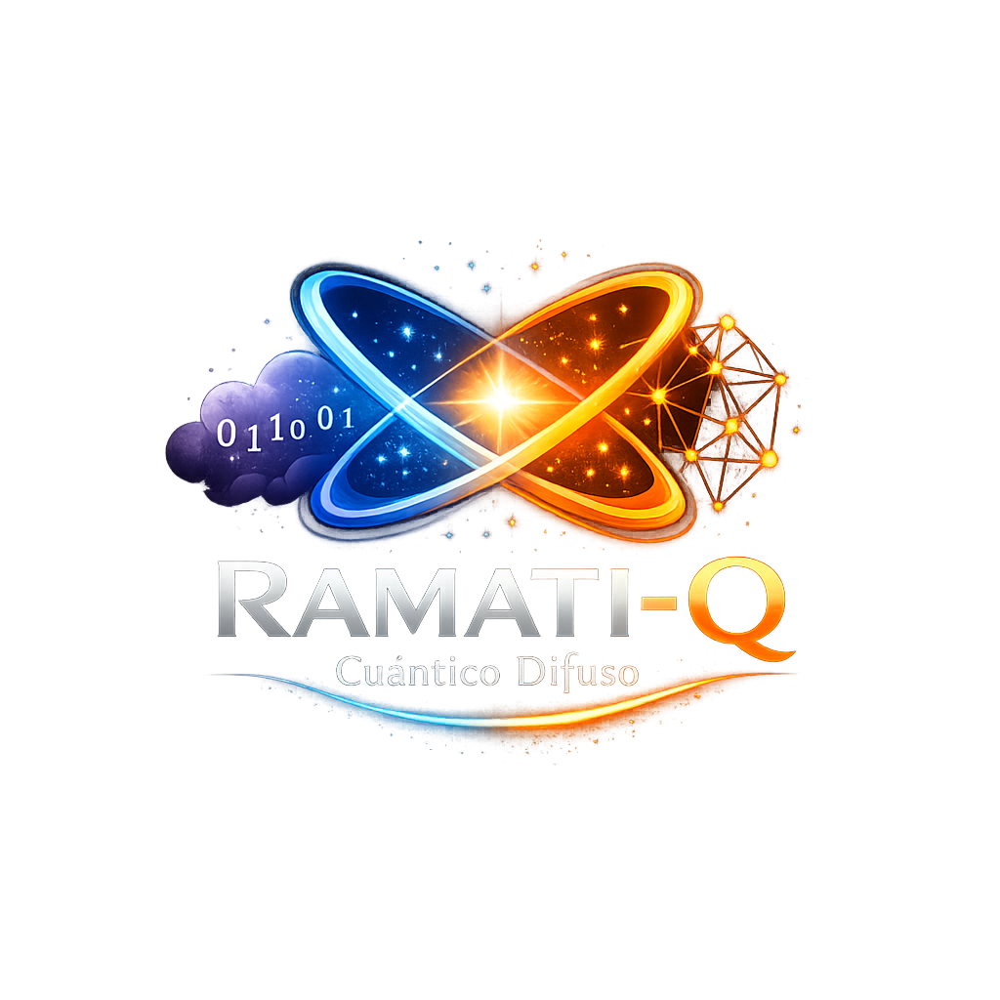

<p align="center">
  
</p>

# RAMATI-Q

<p align="center">
  
  
  
  
</p>

## Lenguaje nativo para inteligencia cognitiva, robótica y lógica difusa

Ramati-Q es un lenguaje de programación original diseñado para sistemas inteligentes, automatización cognitiva, robótica y toma de decisiones con incertidumbre. Combina una sintaxis clara en español, un motor difuso nativo y una arquitectura pensada para ejecución autónoma.

> Ramati-Q es la cara visible del proyecto. Rust aporta la infraestructura técnica, pero la identidad, la misión y la presencia pública del ecosistema pertenecen a Ramati-Q.

---

## ¿Por qué Ramati-Q?

Ramati-Q no nace para repetir paradigmas existentes. Nace para ofrecer una base propia para programar sistemas que interpretan contexto, reaccionan con criterio y operan de manera inteligente en entornos complejos.

- Sintaxis original y legible
- Lógica difusa integrada desde el núcleo
- Enfoque orientado a robótica, automatización y control cognitivo
- Arquitectura modular y preparada para evolución
- Compilador nativo con identidad propia
- Experiencia de programación en español

---

## Estado del proyecto

### Fase 1.0 ✅
Núcleo fundacional

### Fase 1.2 ✅
Conciencia del entorno

### Fase 1.5 ✅
Piloto autónomo certificado

### Fase 2.0 🚧
Sistema cognitivo de planificación y ejecución avanzada

### Estado público
Early access / prototipo funcional con visión clara de lanzamiento

---

## Tecnologías principales

- Rust como base de infraestructura técnica
- Cargo como herramienta de compilación
- Arquitectura modular
- Simulación cognitiva
- Motor difuso interno
- Compilador propio con identidad Ramati-Q

---

## Requisitos

- Rust + Cargo
- Sistema operativo: Windows, Linux o macOS
- Git

---

## Instalación

```bash
git clone https://github.com/ITAMAR74IA/Ramati-Q.git
cd Ramati-Q
cargo build --release
```

Luego ejecuta el binario generado en la carpeta `target/release`.

---

## Ejemplo rápido

```rmq
objetivo 80.0 80.0
espectro distancia_frontal = 1.0

bucle_cognitivo 150 ->
    capturar distancia_frontal de sensor_frontal
    si_difuso distancia_frontal < 0.5 ->
        accionar giro_izquierda con 1.0
    fin_si
fin_bucle
```

Este ejemplo representa la visión del lenguaje: objetivos, espectros, decisiones difusas y ejecución cognitiva orientada a sistemas inteligentes.

---

## Roadmap

### Próximamente
- Mejorar el compilador y la validación semántica
- Extender la librería estándar
- Crear ejemplos reales de robótica y automatización
- Integrar más módulos de control cognitivo
- Preparar releases oficiales para Windows, Linux y macOS
- Estabilizar la documentación y el ecosistema público

---

## Contribuir

Las contribuciones son bienvenidas. Puedes colaborar con:

- Mejora del compilador
- Correcciones de semántica
- Ejemplos y tutoriales
- Módulos de librería
- Pruebas de validación
- Documentación y community building

---

## Licencia

MIT License

---

## Comunidad y contacto

- GitHub: https://github.com/ITAMAR74IA/Ramati-Q
- Proyecto: Ramati-Q
- Filosofía: programación cognitiva en español para estudiantes, makers, investigadores, ingenieros y creadores de sistemas inteligentes

---

Proyecto Ramati-Q © 2025-2026
